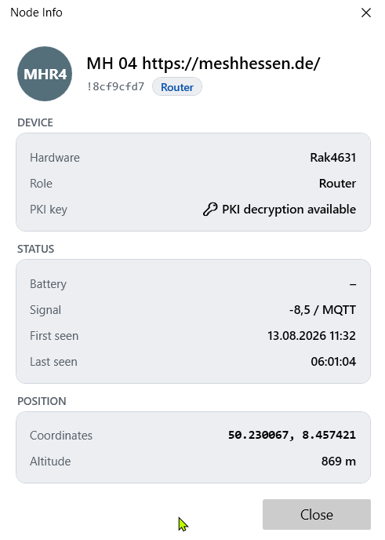
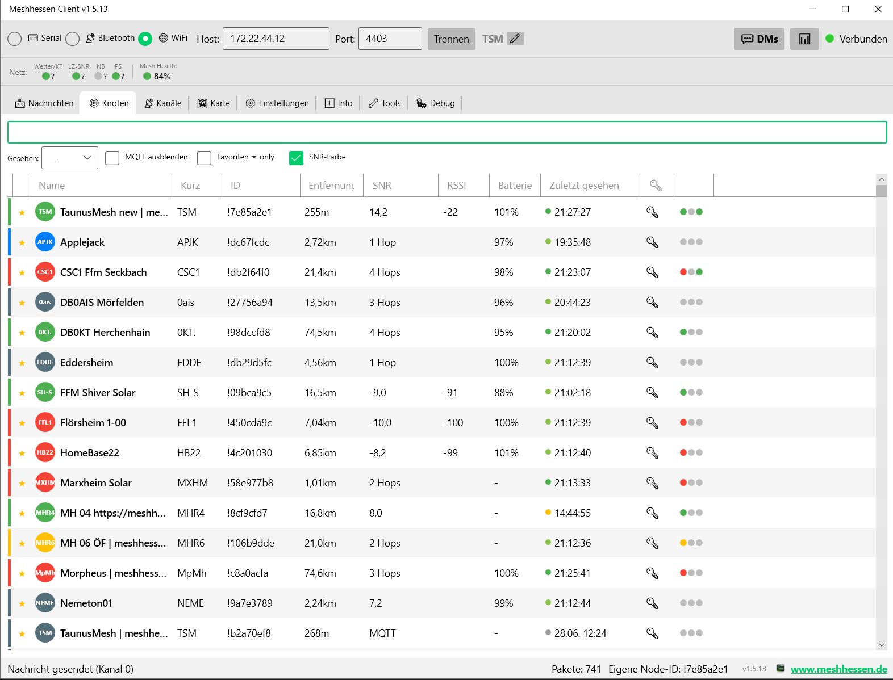
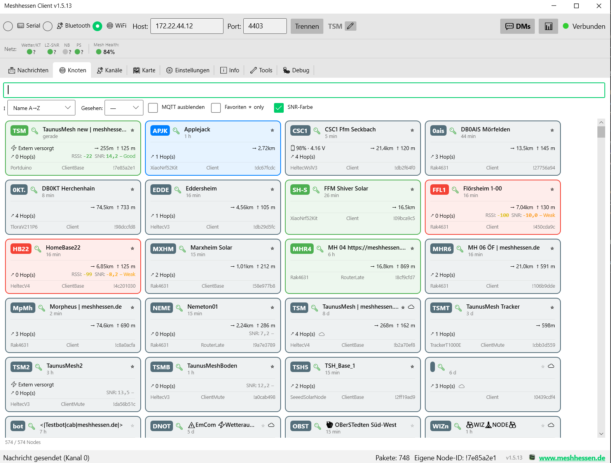
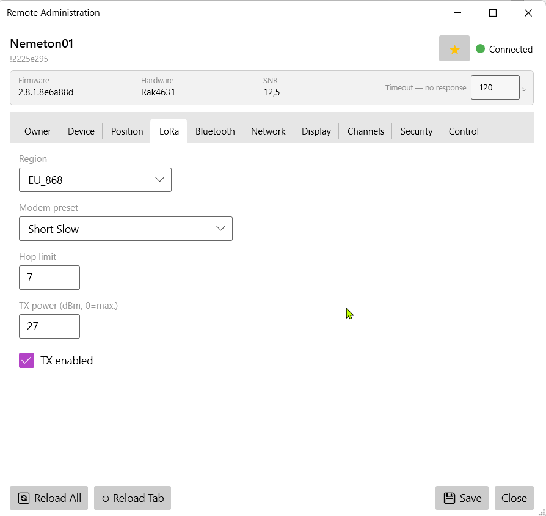
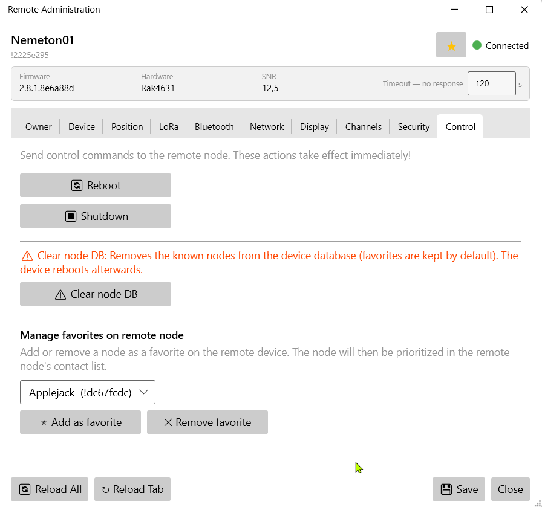

# 🔧 Node-Verwaltung & Fernkonfiguration

[← Handbuch-Übersicht](../index.md) · [🇬🇧 English version](https://meshhessenclient.de/handbuch/en/node-management/)

## Knoten-Übersicht

* **Alle Nodes im Mesh** mit SNR, Batterie, Entfernung, Hop-Anzahl
  * **Kachelansicht (Fancy View)** – optional in Einstellungen → Darstellung aktivierbar: tauscht die Tabelle gegen eine responsive Kachel-Oberfläche (Spaltenanzahl wächst/schrumpft mit der Fensterbreite)
    * Pro Kachel: ShortName-Badge in Node-Farbe, 🔑/🔓 PKI-Status, voller Name, „vor X min", ⭐-Favoritenstern, 📡 Infrastruktur- und ☁ MQTT-Symbol; ab Firmware 2.8 zusätzlich 📶 („direkt per Funk gehört", vom Gerät gemeldet) und 💬 mit dem Status-Text des Nodes
    * Strom (extern versorgt oder Batterie + Spannung), Entfernung + Höhe, Hops, RSSI/SNR mit Farbverlauf, Umwelt-Telemetrie (🌡/💧/🌬), Hardware-Modell · Geräterolle · Node-ID
    * Eigener Node immer ganz oben, virtualisiertes Scrolling auch bei 1000+ Nodes
  * **SNR/RSSI nur bei direktem Empfang** – Signalwerte werden nur angezeigt, wenn wir den Node direkt (0 Hops, kein MQTT) hören; bei Relay-Nodes zeigt die Spalte stattdessen die Hop-Anzahl
  * **Erweiterte Filter** – nach „zuletzt gesehen" (5 Min bis 60 Tage), MQTT-Nodes ausblenden, nur Favoriten, SNR-Einfärbung an/aus; Sortier-Dropdown im Kachelmodus
* **Informationen anfordern** – Rechtsklick-Untermenü (Liste, Kachel, Karte) fordert wie die Android-App gezielt Daten von einem Node an: Benutzer-Info, Position, Geräte-/Umwelt-/Luftqualität-/Strom-/Host-Metriken, Signalqualität/Mesh-Statistik, PAX-Zähler
* **Node-Info-Fenster** – Rechtsklick auf einen Node (Liste, Kachel, Karte oder Nachricht) → „ℹ️ Node Info“: Hardware-Modell, Rolle, PKI-Status, Akku, Signal, Zuerst/Zuletzt gesehen und Position. Die Firmware-Version des eigenen Geräts steht unter Einstellungen → Geräteinfo; die eines entfernten Nodes zeigt das Fernverwaltungs-Fenster:

* **Node-Status (💬)** – Nodes mit Firmware ≥ 2.7.20 können einen Freitext-Status funken („Im Urlaub bis 20.11.", „Solar, Akku schwach"). Empfangene Statuses erscheinen in der Node-Liste (💬-Symbol mit Tooltip), in der Kachelansicht als eigene Zeile und als Banner im Node-Info-Fenster; der letzte Status je Node überlebt Client-Neustarts. **Eigenen Status setzen:** Status-Button in der Kopfzeile (neben dem Funk-Echo-Radar) → Text eingeben (max. 79 Byte, Umlaute zählen doppelt) → OK. Das Gerät übernimmt ohne Neustart und funkt den Status bei Änderung sowie ca. alle 12 Stunden; leeres Feld löscht ihn
* **PKI-Schlüssel-Indikator** – 🔑-Spalte zeigt, ob der Public Key des Nodes bekannt ist
* **Node-Farben** – Nodes individuell einfärben (Karte + Listen)
* **Node-Notizen** – Freitext-Notizen pro Node
* **Nodes anpinnen** – Nodes in der Liste oben fixieren (unabhängig von Sortierung)
* **Favoriten** – Nodes als Favoriten markieren (★-Symbol, Rechtsklick-Menü); wird mit dem Gerät synchronisiert (`set_favorite_node` / `remove_favorite_node`); Favoriten erscheinen oben in der Liste

Node-Übersicht als Tabelle – mit Avatar, Signal-LEDs, Filtern und Sortierung:

Node-Übersicht als Kachelansicht (Fancy View) – mit Telemetrie, Strom und Signalqualität pro Kachel:

## Fernverwaltung (Remote Admin)

Vollständige Remote-Admin-Oberfläche für Favoriten-Nodes — funktioniert auch über Relay- und MQTT-Strecken:

### So administrierst du einen entfernten Node (Schritt für Schritt)

1. **Voraussetzungen:** Dein Public Key muss auf dem Ziel-Node als Admin-Schlüssel eingetragen sein (Security-Tab des Ziel-Nodes, Admin-Schlüssel 1–3) — oder du nutzt einen gemeinsamen Admin-Channel. Außerdem muss der Ziel-Node den Public Key deines Nodes kennen (PKI).
2. Ziel-Node als **Favorit** markieren (★ im Rechtsklick-Menü) — der Auswahl-Dialog der Fernverwaltung listet nur Favoriten
3. **„🛠️ Fernverwaltung"** öffnen (Rechtsklick in der Kachelansicht oder Einstellungen → Fernverwaltung) und im Dialog den Favoriten wählen — der Client handelt einen Session-Schlüssel aus und lädt die Konfiguration (wahlweise alles sofort oder pro Tab beim Öffnen). Nach dem ersten gültigen Zugriff markiert der Ziel-Node deinen Admin-Node übrigens automatisch als Favorit, damit dein Schlüssel dort nicht aus der Node-Datenbank verdrängt wird
4. Einstellungen ändern → **„Speichern"** schreibt sie über Funk zurück; der Ziel-Node startet bei Bedarf neu
5. **Typische Fehler:** Timeout ohne Antwort → Admin-Schlüssel fehlt auf dem Ziel oder der Node ist gerade nicht erreichbar (Traceroute testen); PKI-Fehler → Public Key des Ziels fehlt lokal (Node einmal direkt empfangen oder per „📥 Informationen anfordern → Benutzer-Info" den Key ziehen). Ablehnungen meldet der Client mit konkretem Grund statt still zu scheitern.
6. Über mehrere Hops dauert jede Antwort einige Sekunden — der **Timeout** ist einstellbar (Standard 30 s; im Fenster live 5–300 s), einzelne Tabs lassen sich per „↻ Tab neu laden" wiederholen

Auch **Favoriten auf dem entfernten Gerät** lassen sich remote setzen/entfernen:

Features im Überblick:

* Alle Konfigurations-Reiter: Besitzer, Gerät, Position, LoRa, Bluetooth, Netzwerk, Anzeige, Kanäle, **Sicherheit**, Steuerung
* **Sicherheits-Reiter:** Public Key (read-only, Base64), Admin-Schlüssel 1–3 (Base64), Flags (Admin Channel, Managed Mode, Serial, Debug Log), Paket-Signatur-Richtlinie (Firmware 2.8: Kompatibel / Ausgewogen / Strikt)
* **Favoriten remote verwalten:** Knoten auf dem Remote-Gerät als Favorit setzen oder entfernen
* Session-Schlüssel-Handshake, konfigurierbarer Timeout, per-Channel Retry + Neu-laden
* **Lazy Loading:** Beim Öffnen wählen, ob alles sofort oder seitenweise geladen wird; „↻ Tab neu laden"-Button für gezielten Reload einzelner Reiter

## Node-Konfiguration (lokal)

Vollständige Gerätekonfiguration direkt aus dem Client, alle Module auf einer Seite:

* **Gerät & LoRa:** Region, Modem-Preset, TX-Power, Hop-Limit, Geräterolle, Rebroadcast-Modus
* **Position:** GPS-Modus, Smart-Broadcast, feste Position mit Koordinaten-Eingabe; „Von Karte wählen" öffnet ein eigenes Kartenfenster (honoriert Offline-/Online-Einstellungen); „Eigener Kartenpin" übernimmt die per Rechtsklick gesetzte Position
* **Netzwerk:** WLAN SSID/PSK, DHCP/statische IP, Ethernet, NTP-Server, Syslog
* **Display:** Screen-Timeout, Carousel, Kompass, 12h-Uhr, metrisch/imperial, Display-Modus, OLED-Typ
* **MQTT:** Server, Credentials, TLS, JSON-Modus, Root-Topic, Proxy-Modus, Map-Reporting mit Genauigkeitsstufe (Bits 10–19), MQTT-Proxy-Client-Funktion
* **Telemetrie:** Geräte-, Umgebungs-, Luftqualitäts- und Energiemetrik-Intervalle
* **Bluetooth:** Aktivieren, Pairing-Modus, fixer PIN; **BT-PIN ändern** direkt aus dem Client
* **Security:** Public Key anzeigen (read-only), Private Key anzeigen/ändern, Admin-Schlüssel, Managed Mode, Paket-Signatur-Richtlinie (Firmware 2.8: Kompatibel/Ausgewogen/Strikt — Standard Kompatibel; „Strikt" ignoriert Pakete älterer Nodes!)
* **Kanäle:** Alle 8 Kanäle – Rolle, Name, Uplink, Downlink, Positions-Genauigkeit (Bits 10–19, ~23 km bis ~45 m). Kanäle mit aktivierter AEAD-Verschlüsselung (Firmware 2.8, experimentell) zeigt die Kanalliste mit 🛡-Symbol
* **Weitere Module (volle Android-Parität):** Nachbar-Info, Store & Forward, Externe Benachrichtigung, Canned Messages, Range Test, Serial (alle Modi inkl. WS85, VE.Direct, MODBUS), Audio (Codec2-Sprachfunk), Remote Hardware, Ambient Lighting, Detection Sensor, Paxcounter, TAK/ATAK (FW 2.8) und **Mesh Beacon** (FW 2.8: Beacons empfangen/senden, Nachricht, Kanal-/Preset-Angebot — Achtung: Broadcast auf einem fremden Preset schaltet das Funkmodul um, währenddessen kein Empfang auf dem primären Preset; für Router ungeeignet). Mesh Beacon gibt es auch als eigenen Reiter in der Fernverwaltung

!!! note "Namenslängen sind Byte-Grenzen"
    Das Funkprotokoll begrenzt Namen in **Bytes**, nicht Zeichen — Umlaute und Sonderzeichen zählen doppelt. Kanalnamen: max. 11 Byte. Node-Langname: max. 24 Byte ab Firmware 2.8 (ältere Firmware: 39), Kurzname: 4 Byte. Der Client prüft das beim Speichern und warnt, bevor das Gerät einen zu langen Namen still verwerfen würde.

## Konfiguration sichern & wiederherstellen

Im **Tools-Tab** unter „💾 Konfiguration sichern & wiederherstellen":

* **Backup erstellen** schreibt die komplette Konfiguration des verbundenen Nodes als JSON-Datei (Vorschlag: `firmware\backups\node-<ID>-<Datum>.json`): Owner (Lang-/Kurzname), alle Config-Abschnitte (Gerät, Position, Energie, Netzwerk, Display, LoRa, Bluetooth, Sicherheit), alle Modul-Konfigurationen und alle 8 Kanäle **inklusive Schlüssel**. Die Datei enthält damit auch WLAN-Zugangsdaten und den privaten Schlüssel des Nodes – vertraulich behandeln. Der Firmware-Assistent legt dasselbe Backup optional vor jedem Update an.
* **Backup wiederherstellen** liest eine solche Datei ein, zeigt vorher eine Zusammenfassung (Quell-Node, Firmware-Versionen, enthaltene Abschnitte) und schreibt nach Bestätigung alles in einer Transaktion zurück – das Gerät startet danach einmal neu. Stammt das Backup von einem **anderen** Node, wird der Sicherheits-Abschnitt (privater Schlüssel, Admin-Schlüssel) bewusst ausgelassen, damit nicht zwei Nodes mit derselben Identität entstehen; Owner, LoRa, Kanäle und Module werden trotzdem übernommen – praktisch für Ersatzgeräte.

## Geräte-Display spiegeln (Firmware 2.8)

Meldet das verbundene Gerät in seinen Metadaten ein Display, erscheint im **Tools-Tab** der Abschnitt „📺 Geräte-Display spiegeln": Ein Klick öffnet ein Fenster mit dem Live-Bild des Node-Displays — praktisch für Geräte, die verbaut oder schwer erreichbar montiert sind. Unterstützt werden Mono-OLEDs (inklusive Farb-Zonen, falls das Gerät eine Palette mitliefert) und Farb-Displays (TFT); das Bild wird pixelgenau skaliert. Die Spiegelung funktioniert nur über die lokale Verbindung (USB/BLE/WLAN, nicht übers Mesh) und endet mit dem Schließen des Fensters.
