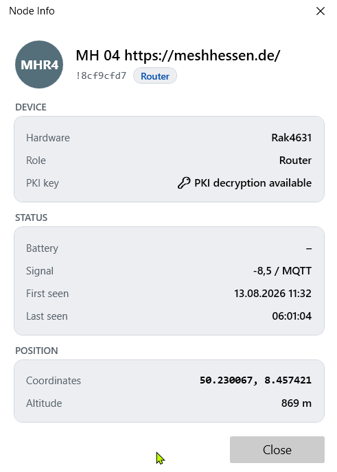
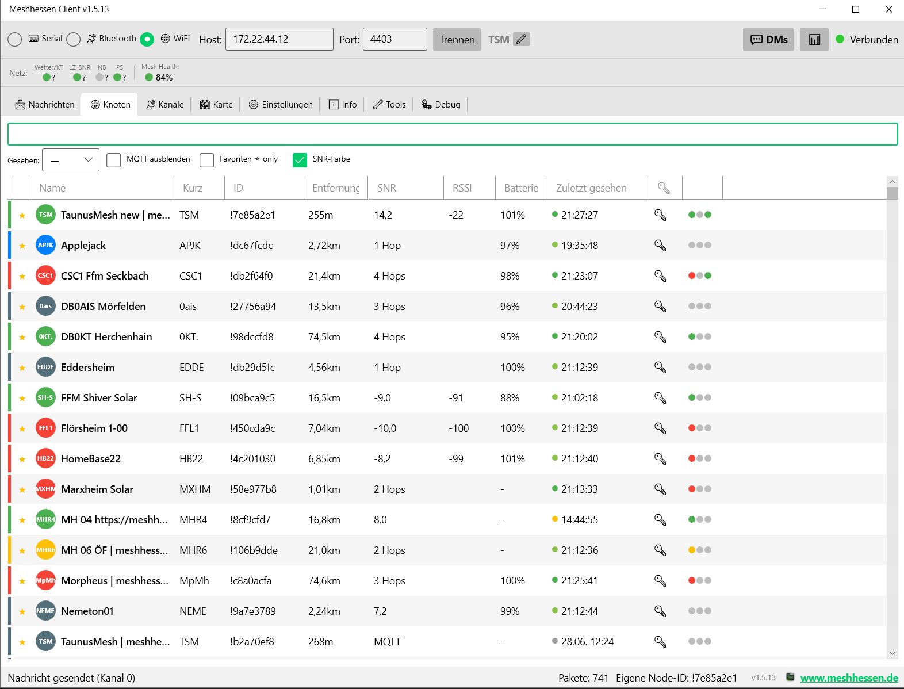
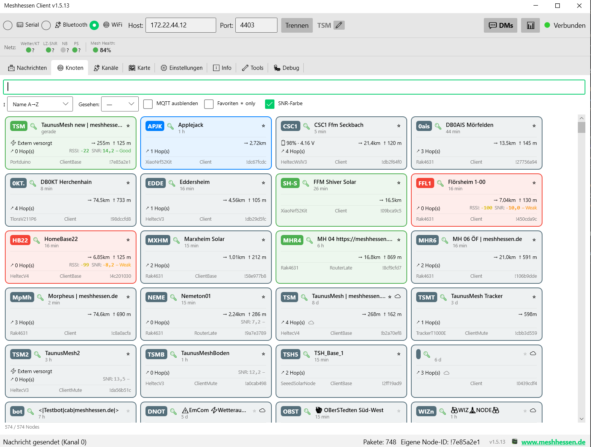
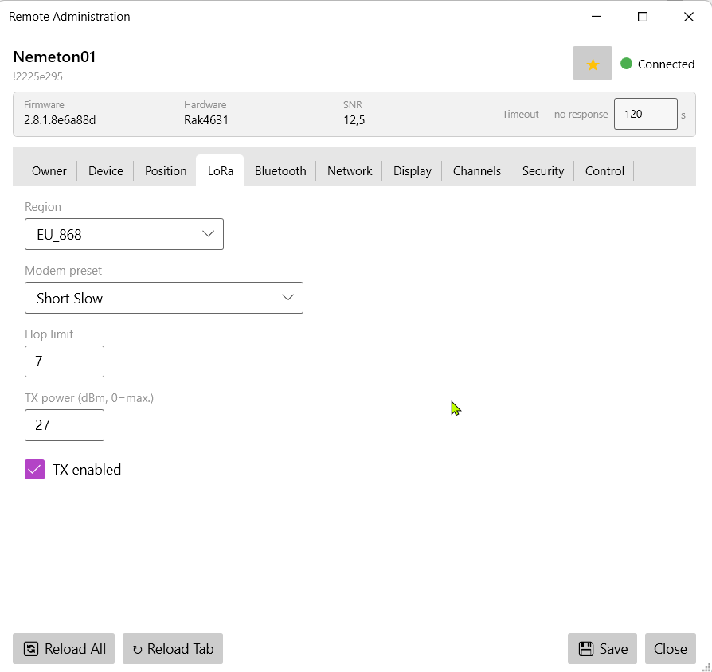
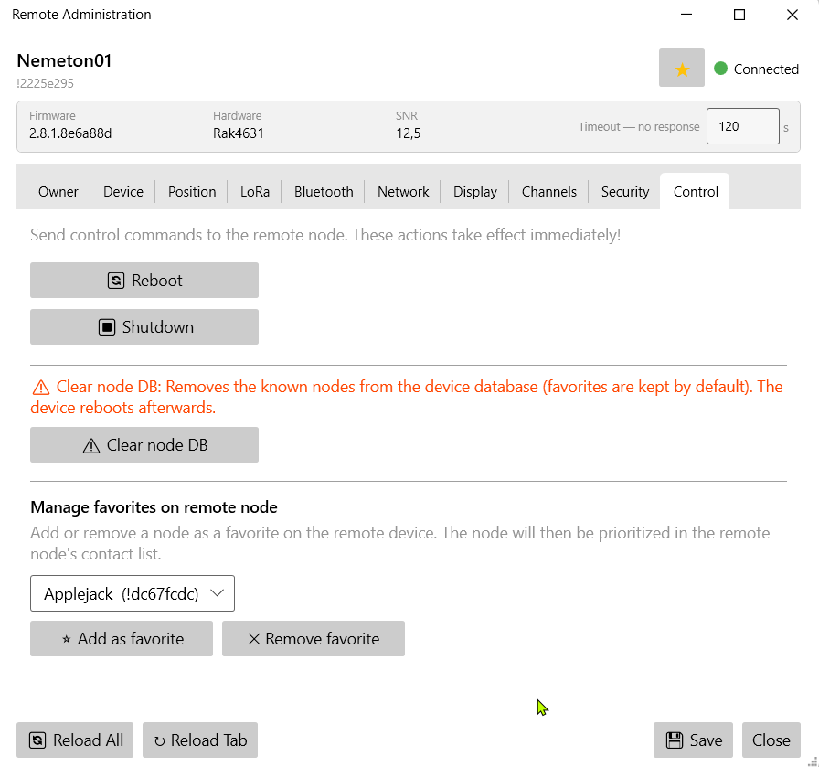

# 🔧 Node Management & Remote Admin

[← Handbook home](index.md) · [🇩🇪 Deutsche Version](https://meshhessenclient.de/handbuch/de/node-verwaltung/)

## Node overview

* **All nodes in the mesh** with SNR, battery, distance, hop count
  * **Tile view (Fancy View)** – optionally enabled in Settings → Appearance: replaces the table with a responsive tile surface (column count grows/shrinks with the window width)
    * Per tile: ShortName badge in node color, 🔑/🔓 PKI status, full name, "X min ago", ⭐ favorite star, 📡 infrastructure and ☁ MQTT icons; with firmware 2.8 also 📶 ("heard directly over the radio", reported by the device) and 💬 with the node's status text
    * Power (externally powered or battery + voltage), distance + altitude, hops, RSSI/SNR with color gradient, environment telemetry (🌡/💧/🌬), hardware model · device role · node ID
    * Own node always on top, virtualized scrolling even with 1000+ nodes
  * **SNR/RSSI only for direct reception** – signal values are shown only when we hear the node directly (0 hops, no MQTT); for relayed nodes the column shows the hop count instead
  * **Advanced filters** – by "last seen" (5 min to 60 days), hide MQTT nodes, favorites only, SNR coloring on/off; sort dropdown in tile mode
* **Request information** – right-click submenu (list, tile, map) requests data from a node like the Android app: user info, position, device/environment/air-quality/power/host metrics, signal quality/mesh stats, PAX counter
* **Node info window** – right-click a node (list, tile, map or message) → "ℹ️ Node Info": hardware model, role, PKI status, battery, signal, first/last seen and position. Your own device's firmware version lives under Settings → Device info; a remote node's is shown in the remote admin window:

* **Node status (💬)** – nodes with firmware ≥ 2.7.20 can broadcast a free-text status ("On vacation until Nov 20", "Solar, battery low"). Received statuses appear in the node list (💬 icon with tooltip), as a line on the tile and as a banner in the node info window; the last status per node survives client restarts. **Set your own status:** status button in the header bar (next to the Funk-Echo radar) → enter text (max. 79 bytes, umlauts count twice) → OK. The device applies it without rebooting and broadcasts it on change plus roughly every 12 hours; an empty field clears it
* **PKI key indicator** – 🔑 column shows whether a node's public key is known
* **Node colors** – color-code nodes individually (map + lists)
* **Node notes** – free-text annotations per node
* **Pin nodes** – pin nodes to the top of the list (independent of sorting)
* **Favorites** – mark nodes as favorites (★ icon, right-click menu); synced with the device (`set_favorite_node` / `remove_favorite_node`); favorites shown at the top of the list

Node overview as a table – with avatar, signal LEDs, filters and sorting:

Node overview as tile view (Fancy View) – with telemetry, power and signal quality per tile:

## Remote administration

Full remote admin UI for favorite nodes — also works across relay and MQTT paths:

### How to administer a remote node (step by step)

1. **Prerequisites:** your public key must be registered as an admin key on the target node (its security tab, admin keys 1–3) — or you share an admin channel. The target also needs to know your node's public key (PKI).
2. Mark the target node as a **favorite** (★ in the right-click menu) — the remote-admin selection dialog only lists favorites
3. Open **"🛠️ Remote Administration"** (right-click in the tile view, or Settings → Remote administration) and pick the favorite in the dialog — the client negotiates a session key and loads the configuration (either everything at once or per tab on demand). After the first valid access the target automatically marks your admin node as a favorite, so your key cannot be evicted from its node database
4. Change settings → **"Save"** writes them back over the air; the target reboots if required
5. **Typical failures:** timeout without a response → admin key missing on the target or the node is currently unreachable (try a traceroute); PKI error → the target's public key is missing locally (receive the node directly once or pull it via "📥 Request information → User info"). Rejections are reported with a concrete reason instead of failing silently.
6. Across multiple hops every answer takes a few seconds — the **timeout** is adjustable (default 30 s; 5–300 s live in the window); individual tabs can be retried via "↻ Reload Tab"

**Favorites on the remote device** can be set/removed remotely, too:

Feature overview:

* All configuration tabs: Owner, Device, Position, LoRa, Bluetooth, Network, Display, Channels, **Security**, Control
* **Security tab:** public key (read-only, Base64), admin keys 1–3 (Base64), flags (admin channel, managed mode, serial, debug log), packet signature policy (firmware 2.8: Compatible / Balanced / Strict)
* **Manage favorites remotely:** set or remove favorites on the remote device
* Session-key handshake, configurable timeout, per-channel retry + reload
* **Lazy loading:** choose on open whether everything loads immediately or page by page; "↻ Reload Tab" button per tab

## Node configuration (local)

Full device configuration directly from the client, all modules in one window:

* **Device & LoRa:** region, modem preset, TX power, hop limit, device role, rebroadcast mode
* **Position:** GPS mode, smart broadcast, fixed position with coordinate input; "Pick from Map" opens a dedicated map picker window; "Own Map Pin" copies the position set via right-click
* **Network:** Wi-Fi SSID/PSK, DHCP/static IP, Ethernet, NTP server, syslog
* **Display:** screen timeout, carousel, compass, 12h clock, metric/imperial, display mode, OLED type
* **MQTT:** server, credentials, TLS, JSON mode, root topic, proxy mode, map reporting with precision level (bits 10–19), MQTT proxy client
* **Telemetry:** device, environment, air quality and power metric intervals
* **Bluetooth:** enable, pairing mode, fixed PIN; **change BT PIN** directly from the client
* **Security:** show public key (read-only), show/change private key, admin keys, managed mode, packet signature policy (firmware 2.8: Compatible/Balanced/Strict — default Compatible; "Strict" ignores packets from older nodes!)
* **Channels:** all 8 channels – role, name, uplink, downlink, position precision (bits 10–19, ~23 km to ~45 m). Channels with AEAD encryption enabled (firmware 2.8, experimental) carry a 🛡 icon in the channel list
* **Additional modules (full Android parity):** neighbor info, store & forward, external notification, canned messages, range test, serial (all modes incl. WS85, VE.Direct, MODBUS), audio (Codec2 voice), remote hardware, ambient lighting, detection sensor, paxcounter, TAK/ATAK (FW 2.8) and **Mesh Beacon** (FW 2.8: receive/broadcast beacons, message, channel/preset offer — careful: broadcasting on a foreign preset switches the radio over, with no reception on the primary preset meanwhile; unsuitable for routers). Mesh Beacon is also a dedicated tab in remote admin

!!! note "Name lengths are byte limits"
    The radio protocol limits names in **bytes**, not characters — umlauts and special characters count twice. Channel names: max. 11 bytes. Node long name: max. 24 bytes from firmware 2.8 (older firmware: 39), short name: 4 bytes. The client validates this on save and warns before the device would silently reject an oversized name.

## Back up & restore the configuration

In the **Tools tab** under "💾 Back up & restore configuration":

* **Create backup** writes the complete configuration of the connected node to a JSON file (suggested: `firmware\backups\node-<ID>-<date>.json`): owner (long/short name), all config sections (device, position, power, network, display, LoRa, Bluetooth, security), all module configurations and all 8 channels **including keys**. The file therefore also contains Wi-Fi credentials and the node's private key – treat it as confidential. The firmware assistant optionally creates the same backup before every update.
* **Restore backup** reads such a file, shows a summary first (source node, firmware versions, contained sections) and, after confirmation, writes everything back in one transaction – the device reboots once afterwards. If the backup comes from a **different** node, the security section (private key, admin keys) is deliberately left out so that two nodes never share one identity; owner, LoRa, channels and modules are still applied – handy for replacement devices.

## Mirror the device display (firmware 2.8)

If the connected device reports a display in its metadata, the **Tools tab** shows a "📺 Mirror Device Display" section: one click opens a window with a live image of the node's screen — handy for devices that are built in or mounted out of reach. Mono OLEDs (including color zones when the device supplies a palette) and color TFT displays (partial updates) are supported; the image is scaled pixel-perfectly. Mirroring only works over the local connection (USB/BLE/Wi-Fi, not across the mesh) and stops when the window is closed.
